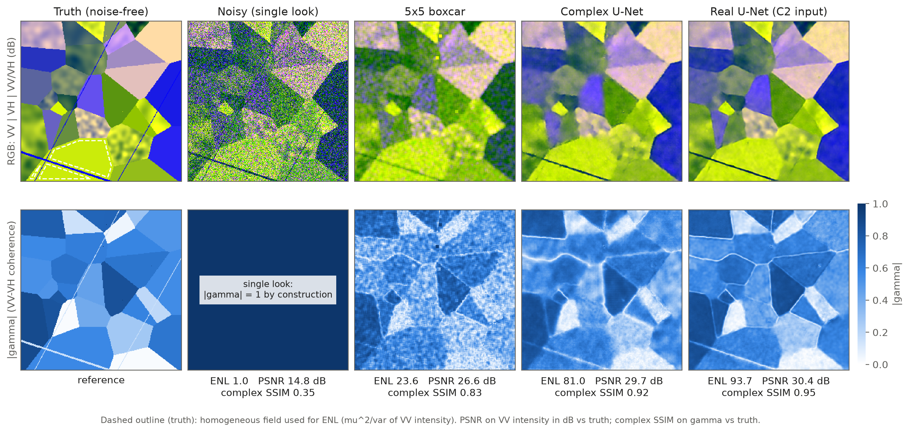
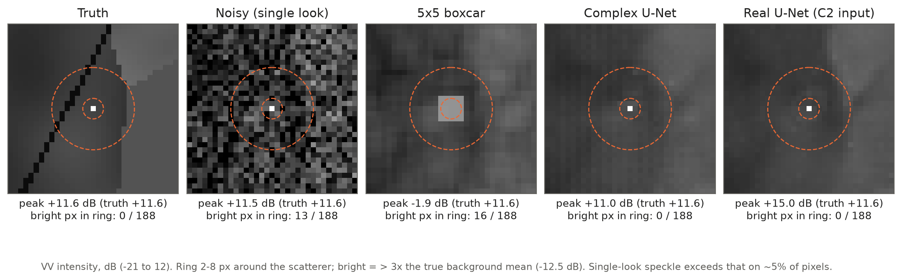
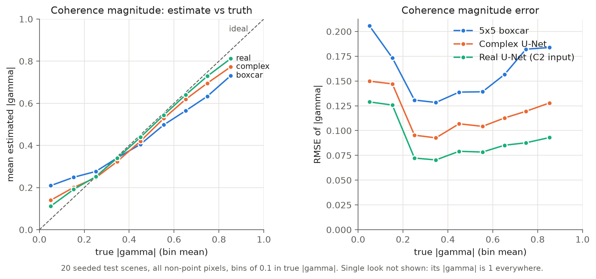

# SAR Coherence Preserving Despeckling

**Simulation experiment: despeckling dual-pol SAR while preserving VV–VH coherence**

A controlled experiment on **fully synthetic** Sentinel-1-like dual-pol (VV/VH) scenes where the noise-free covariance
is known exactly. Single-look speckle is added, a network is trained with **supervision against the known truth**, and
the output is checked for one thing above all: is the complex VV–VH coherence γ = C₁₂ / √(C₁₁ C₂₂) preserved, in both
magnitude and phase?

Two networks are compared against classical multilooking:

- **Complex U-Net.** Its input is the two complex single-look pixels (S_VV, S_VH), with complex-valued layers in the
  style of Trabelsi et al. 2018, *Deep Complex Networks*.
- **Real U-Net (baseline).** The project's existing U-Net, whose input is the single-look covariance
  [C₁₁, C₂₂, Re C₁₂, Im C₁₂].



*Top: intensity composite (R = VV, G = VH, B = VV/VH, dB). Bottom: |γ|. ENL is computed in the dashed homogeneous
field. A single look always has |γ| = 1, so the noisy panel's coherence map carries no information.*

## Results

All numbers are averages over 20 seeded 256 × 256 test scenes that training never sees.

| Method | ENL ↑ | PSNR ↑ | Complex SSIM ↑ | Phase error ↓ | Bright px around a point ↓ | Point peak error |
|---|---|---|---|---|---|---|
| Noisy single look | 1.0 | 15.8 dB | 0.285 | 43.9° | 10.6 | 0.0 dB |
| 5 × 5 boxcar | 25.6 | 26.3 dB | 0.787 | 9.9° | 13.1 | −12.9 dB |
| **Complex U-Net** | **92.8** | **28.9 dB** | **0.892** | **6.1°** | **0.4** | **−0.8 dB** |
| **Real U-Net** (C2 input) | **126.4** | **30.0 dB** | **0.935** | **3.6°** | **0.3** | **+0.5 dB** |

- **Speckle is removed.** ENL rises from 1 to about 90–125, 3.6–4.9× that of a 5 × 5 boxcar. PSNR improves by
  13–14 dB over the noisy image and by 2.6–3.7 dB over the boxcar.
- **Coherence is preserved better than with multilooking.** Complex SSIM on γ and the median phase error (pixels with
  true |γ| > 0.3) both beat the boxcar.
- **Point scatterers keep their intensity.** The boxcar spreads a bright scatterer over 5 × 5 pixels and loses about
  13 dB of peak intensity. Both networks keep the peak within 1 dB and remove almost all speckle spots around it.
- **The real U-Net beats the complex U-Net on every metric.** The likely reason is the input. The real network receives
  the second-order products |S_VV|², |S_VH|² and S_VV S_VH* directly, which are exactly what a covariance estimate is
  built from. The complex network has to learn to form those products from linear complex convolutions and CReLU.
  Its training curve was still improving when the learning-rate schedule ended, so a longer run or a complex output
  layer that forms outer products may close the gap. Both are untested.

### Point scatterers



VV intensity in dB around one scatterer. "Bright pixels" are pixels in the ring 2–8 px from the scatterer that exceed
3× the true background mean. Single-look speckle exceeds that on about 5 % of pixels.

### Coherence bias



- **Low coherence.** All estimators read |γ| too high near |γ| = 0, the usual estimation-bias floor. The networks have
  the smallest bias: +0.06 (real) and +0.09 (complex) against +0.16 for the boxcar in the 0–0.1 bin.
- **High coherence.** The boxcar underestimates high |γ| (−0.12 at 0.8–0.9) because of the VH thermal noise. The
  networks partly correct for it (−0.04 real, −0.08 complex), since they are trained against the noise-free truth.

## Method

### Synthetic scenes ([`sim_scene.py`](src/sar_denoise/sim_scene.py))

Land-like scenes, generated fresh for every training step:

- **Fields:** Voronoi polygons with VV σ⁰ between −18 and −4 dB and VH 5–12 dB below VV.
- **Coherence:** each field gets a complex γ with |γ| uniform on [0, 0.9] and a uniform random phase.
- **Texture:** half of the fields have a smooth, mean-1 multiplicative texture applied to both channels, so γ is
  unchanged. The other half are homogeneous; ENL is measured in those.
- **Roads:** thin, dark lines with low coherence.
- **Point scatterers:** a deterministic complex vector 15–25 dB above the local background, with |γ| = 0.95.

Every truth pixel is positive definite (|γ| < 1).

### Speckle

Each observation is a single look, k = a + CN(0, C_diffuse) + CN(0, diag(0, n_VH)):

- **a** is the deterministic point-scatterer vector (zero away from points).
- **CN(0, C_diffuse)** is fully developed circular complex Gaussian speckle.
- **n_VH** is VH thermal noise with NESZ between −28 and −24 dB. The noise is not part of the target, so the network
  has to remove it.

**Check of the truth.** Averaging 1000 independent realisations of one scene recovers the designed coherence:

- |γ| within 0.0013 and phase within 0.23° on every field;
- |γ| within 0.0033 on every point scatterer (single pixel).

Reproduce with `python scripts/check_sim_truth.py`.

### Networks ([`complex_models.py`](src/sar_denoise/complex_models.py), [`models.py`](src/sar_denoise/models.py))

**Complex U-Net** (depth 3, 16 complex base channels, 0.97 M real parameters). MPS has poor complex-dtype support, so
complex values are stored as [Re, Im] pairs of real tensors:

- **Complex convolution** W ∗ x = (A ∗ x_r − B ∗ x_i) + i(B ∗ x_r + A ∗ x_i), computed as one real convolution with
  the block weight [[A, −B], [B, A]].
- **CReLU:** ReLU applied to the real and imaginary parts separately.
- **Complex group normalisation:** per sample, whitening of the 2 × 2 (Re, Im) covariance, with a Trabelsi-style affine
  transform.
- **Downsampling:** average pooling. **Upsampling:** complex transposed convolution.
- **Augmentation:** a random common phase e^{jφ} on both channels, because the absolute phase carries no information.

**Real U-Net baseline** (depth 3, 24 base channels, 1.09 M parameters) on the single-look C2.

**Shared output head.** Both networks predict (log C₁₁, log C₂₂, z) and set γ̂ = tanh(|z|) z/|z|, so every output is a
valid covariance matrix with |γ̂| < 1.

**Normalisation.** Each patch is normalised by its observed mean powers: S_VV / √s₁₁ and S_VH / √s₂₂. The truth gets
the same scaling, which leaves γ and its phase unchanged.

### Loss ([`sim_losses.py`](src/sar_denoise/sim_losses.py))

The per-pixel Kullback–Leibler divergence between the true and estimated complex Gaussian distributions, in closed form
for 2 × 2 matrices:

  KL = tr(Ĉ⁻¹C) − log det(Ĉ⁻¹C) − 2

- **C₁₂ counts as much as the powers.** The loss is only minimised by the correct complex cross term, including its phase.
- **Brightness doesn't skew it.** The loss is invariant to C → DCD for any positive diagonal D, so bright point
  scatterers do not dominate it, dark fields are not ignored, and the per-patch normalisation does not change it.

### Training ([`sim_train.py`](src/sar_denoise/sim_train.py))

- **Data:** 3000 steps × 8 fresh 128 × 128 scenes per network, so no scene is ever repeated and nothing can be memorised.
- **Optimiser:** AdamW, learning rate 10⁻³ with warm-up and cosine decay, gradient clipping at 1.
- **Checkpoint:** a fixed seeded validation set; the best checkpoint is chosen by validation KL.
- **Point density:** point scatterers are 4× denser in training scenes than in test scenes (`--points-per-10k 6`), to
  give them weight in the loss.

### Metrics ([`sim_metrics.py`](src/sar_denoise/sim_metrics.py))

- **ENL** = μ²/σ² of VV intensity over the largest texture-free field, eroded 4 px from its edges.
- **PSNR** on VV intensity in dB: 10 log₁₀(R²/MSE), where R is the dynamic range of the truth in dB.
- **Complex SSIM** on γ with a Gaussian window (σ = 2 px): (2|Σ x y*| + K) / (Σ|x|² + Σ|y|² + K), K = 0.01. It is
  blind to a *constant* phase offset, because the modulus of the sum removes a common rotation, so the median phase
  error is reported alongside it.
- **Point scatterers:** VV intensity at the scatterer, and the number of ring pixels (2–8 px) above 3× the true
  background mean.

## Reproduce

These steps are for a Mac with Apple silicon, where PyTorch runs on the built-in GPU through MPS. CUDA or CPU also
work but are slower or untested.

```bash
source venv/bin/activate
pip install -e .

python scripts/check_sim_truth.py                      # truth check, ~10 s

python -m sar_denoise.sim_train --model complex --out-dir ~/runs/sim_complex --steps 3000 --points-per-10k 6   # ~23 min (M3)
python -m sar_denoise.sim_train --model real    --out-dir ~/runs/sim_real    --steps 3000 --points-per-10k 6   # ~8 min
python -m sar_denoise.sim_eval --complex ~/runs/sim_complex/best.pt --real ~/runs/sim_real/best.pt \
    --out-dir docs/simulation/figures                                                                         # ~1 min

pytest tests -q
```

`sim_eval` writes `showcase_main.png`, `showcase_all.png`, `point_zoom.png`, `gamma_bias.png`, `metrics.md` and
`metrics.json`. The test scenes and the showcase scene come from fixed seeds, so the evaluation is reproducible for a
given checkpoint.

## Limitations

This simulation validates the method under ideal, fully developed speckle. It does **not** show how the method behaves
on real data. The main differences from real Sentinel-1 IW SLCs:

- **Speckle correlation.** Simulated speckle is independent from pixel to pixel. Real SLC speckle is spatially
  correlated because of the processing bandwidth and spectral weighting.
- **Pixel shape.** Pixels are square. Real IW pixels are about 2.3 m × 14 m.
- **Point scatterers** occupy a single pixel, without the sinc sidelobes of a real impulse response.
- **Coherence levels.** Field coherence is spread uniformly over 0–0.9 so that every level gets tested. On real land,
  VV–VH coherence is mostly low.
- **Geometry and noise.** There is no terrain, layover, water or urban double-bounce, and the thermal noise is constant
  across the scene.
- **Statistics.** Each network was trained once (one seed), and the evaluation uses 20 test scenes.

## Files

| File | Purpose |
|---|---|
| `src/sar_denoise/sim_scene.py` | scene generator, speckle simulator, homogeneous mask, truth check |
| `src/sar_denoise/complex_models.py` | complex layers and `ComplexUNet` |
| `src/sar_denoise/sim_losses.py` | closed-form 2 × 2 complex-Gaussian KL loss |
| `src/sar_denoise/sim_train.py` | training with on-the-fly simulated scenes |
| `src/sar_denoise/sim_metrics.py` | ENL, PSNR, complex SSIM, coherence bias, point-scatterer metrics |
| `src/sar_denoise/sim_eval.py` | evaluation and figures |
| `scripts/check_sim_truth.py` | check that averaging realisations recovers the designed coherence |
| `tests/test_sim_*.py`, `tests/test_complex_models.py` | 32 tests (simulator, complex layers vs native complex conv, KL properties, training, metrics, evaluation) |
| `docs/simulation/figures/` | figures and metrics from the run above |
